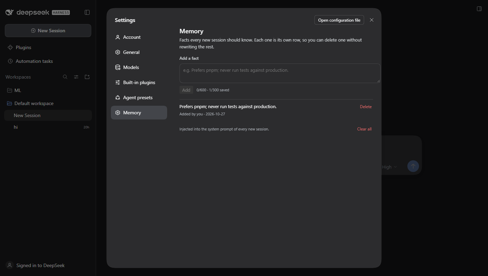

# dsh-memory

A **Memory** page in DeepSeek Harness Settings: one remembered fact per row,
with Add, Delete, and Clear all. No editing a 25 KB `AGENTS.md` to change one
line.

```sh
dsh plugin --profile desktop add github:IlliaDol/dsh-memory   # the app
dsh plugin --profile web add github:IlliaDol/dsh-memory       # dsh web
```

Restart the profile (the desktop app composes its bundle list at boot), then
open **Settings → Memory**.

## Why this exists

dsh's built-in memory is `@deepseek-ai/dsh-agent-instructions`: it loads
`AGENTS.md` / `CLAUDE.md` (and `AGENTS.local.md` / `CLAUDE.local.md`) from the
harness home, the shared agents home, and every directory from the project root
down to the session's cwd. That is a good place for long operating rules, and a
bad place for twenty small facts: the file is edited as one text blob, and
there is no UI at all.

This plugin leaves those files alone. It adds a second, structured store for
the facts you actually add and remove often:

```
Settings → Memory
  ┌────────────────────────────────────────────────┐
  │ Prefers pnpm; never npm install in this repo.  │  Delete
  │ Uses Windows + PowerShell, no bash.            │  Delete
  └────────────────────────────────────────────────┘
  [ Add a fact…                              ] [Add]
```

## What it changes in a session



Each item becomes one bullet of a `## Memory` section evaluated into the
system prompt at assembly time, so an edit in Settings applies to the **next**
turn, not just the next session. The section is capped at 8,000 characters;
the newest items win and the rest are reported as dropped.

The model also gets a `memory` tool:

| Action | Effect |
| --- | --- |
| `list` | every item with its id |
| `add` | append one fact (`max 600 chars`) |
| `update` | replace one item's text |
| `remove` | delete one item by id |
| `clear` | delete everything |

Ask it to "remember that…" and it will use `add`; "forget the pnpm rule" and it
will `list` then `remove`. Every change also shows up in the panel immediately.

## Storage

```
$DSH_HOME/memory.json
{
  "v": 1,
  "items": [
    { "id": "mem_1a2b3c4d", "text": "Prefers pnpm…", "source": "user",
      "createdAt": "2026-10-27T16:40:00.000Z", "updatedAt": "…" }
  ]
}
```

Writes are serialized and atomic (temp file + rename), guarded by a lock
directory so two harness processes cannot read-modify-write the same file at
once, and retried when Windows refuses the rename because a scanner has the
target open for a moment. A byte-order mark in the file (Notepad saves UTF-8
with one) is tolerated. Limits: 300 items, 600 characters each, exact
duplicates refused (case-insensitive).

## It has to work every time, so here is what is guaranteed

The section provider is synchronous — the prompt registry takes a string or a
string-returning function, never a promise — so the plugin reads
`memory.json` on demand rather than warming a cache at load. Three things
follow, and each one has a regression test:

- **The first turn of a fresh process has memory.** An awaited read at load
  loses the race whenever the first assembly beats it; that race is the
  "memory is there sometimes" failure. Reading on demand cannot lose it.
- **A fact added anywhere shows up without a restart.** The file's
  `mtime:size` is checked on every assembly, so a write from the other profile
  (web beside desktop), or a hand edit, is visible on the next turn.
- **A host that cannot place the section still gets the tool and the panel.**
  A renamed section anchor or a duplicate section name is logged, not fatal.

Each load logs one line, so the host log answers "did this session start with
memory?":

```
[dsh-memory] host active; file=C:\Users\illya\.dsh\memory.json
[dsh-memory] prompt section: 3 item(s)
```

`prompt section: 0 item(s)` with a non-empty file means the plugin is reading
somewhere else; no line at all means the bundle never mounted.

### If the plugin disappears after an app update

Both halves live in the profile's load list, not in the app:

```sh
dsh plugin --profile desktop add github:IlliaDol/dsh-memory   # re-adds deps + bundle
```

That one command restores the dependency and the `dsh.profile.bundles` entry
the desktop app composes from; restart the app afterwards. The panel saying
"Memory API is not available on this host" is the same condition.

### Checking it end to end

```sh
dsh --profile <profile> "what do you remember about me?"
```

The answer comes from the prompt section (`memory` tool: `list`). To prove the
prompt path rather than the file on disk, watch for the `prompt section: N
item(s)` line in the same run.

## Security

- The panel's route is `/api/dsh-memory/items` on the host's authenticated
  channel — the same browser-trust fence the harness uses — not a public plugin
  prefix. Another local page cannot POST to it.
- The prompt section tells the model never to store passwords, API keys,
  tokens or private file contents, and the tool description repeats it. That is
  guidance, not a filter: treat `memory.json` as a file on disk, not a vault.
- Deleting an item removes it from the file; there is no history.

## Relationship to AGENTS.md

| Need | Where |
| --- | --- |
| Long operating rules, project conventions | `AGENTS.md` (unchanged) |
| A handful of facts you add and remove often | Settings → Memory |
| Per-directory rules | `AGENTS.md` in that directory |

The two are injected independently; neither rewrites the other.

## Development

```sh
npm test     # store, prompt projection, tool, HTTP handler, client bundle
npm run check
```

No dependencies, no build step. `lib/index.js` is the host half, `lib/client.js`
is the module-loader bundle the shell serves.
